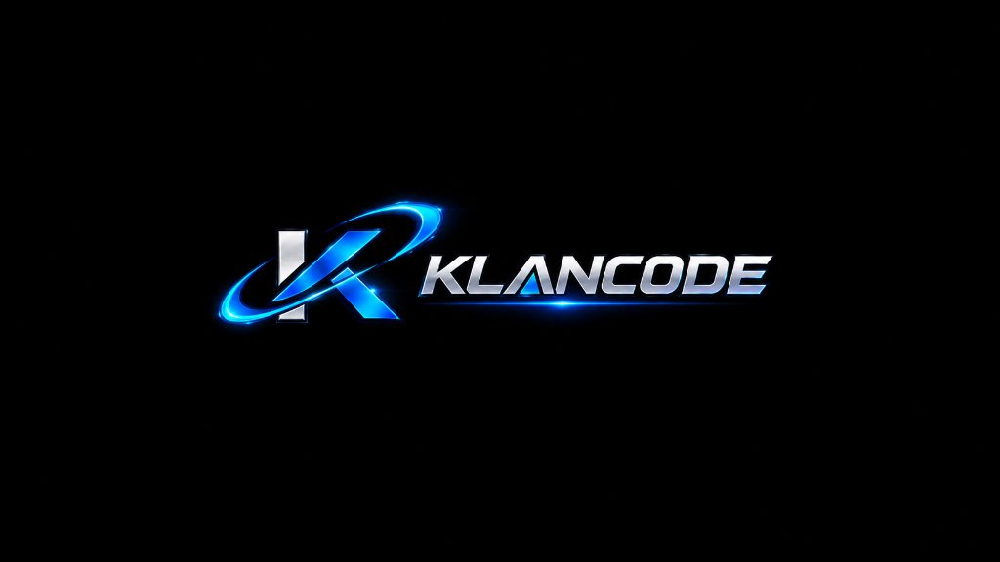

  

  
  
  

---

> **Nota organizacional:** Vitrine pública oficial da **KLANCODE** (organização [`MW-Digital-ai`](https://github.com/MW-Digital-ai), que consolidou a antiga frente MW Digital).

## 👋 Sobre a KLANCODE

A **KLANCODE** conecta empresas a novas oportunidades na internet, unindo desenvolvimento de software, estratégia digital e marketing para criar experiências online alinhadas aos objetivos de cada negócio — do planejamento e design à publicação, SEO e suporte contínuo.

Com base em **Porto Alegre, RS**, trabalhamos para transformar a presença online da sua empresa em resultados concretos.

## 👥 Liderança

- **Matheus Guterres**
- **Wiliam Fagundes**

## 🚀 Como podemos ajudar

- 🌐 **Criação de Sites e Landing Pages** — páginas institucionais e campanhas rápidas feitas para apresentar sua marca e gerar contatos.
- 🛒 **Lojas Virtuais** — experiências de compra com catálogo, carrinho e integração de pagamentos (cartão, Pix e boleto).
- 📈 **Marketing Digital & SEO** — posicionamento local, estrutura técnica de busca e presença consistente.
- 🎧 **Suporte Especializado** — acompanhamento e evolução técnica contínua após a entrega.

## 🧩 Tecnologias e ferramentas

  

  
  
  

## 🤝 Vamos conversar?

Acompanhe nossa organização no GitHub para novidades e projetos públicos. *(Canais de e-mail corporativo oficial em definição — contatos pessoais removidos por política de privacidade e segurança.)*

  

  

